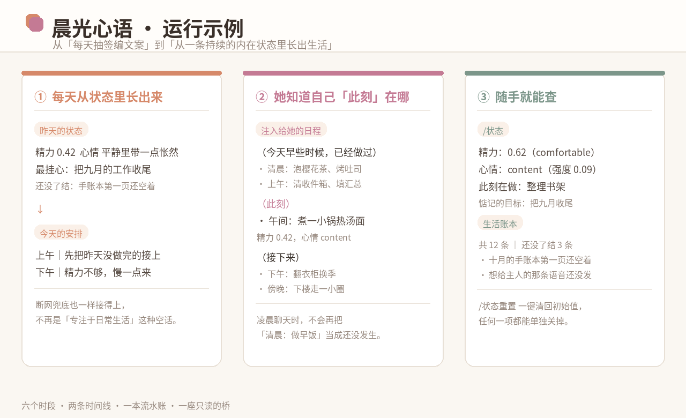

# 🌅 晨光心语 —— AstrBot 人格化日程插件

**每日 AI 风格化日程生成，人格隔离，一键注入。**  
让每一个清晨都有独特的仪式感，让 AI 记住你的每一个身份。

📦 **仓库地址**：[https://github.com/NekoTumble/astrbot_plugin_morning_muse](https://github.com/NekoTumble/astrbot_plugin_morning_muse)

---

## ✨ 核心特性

**📅 日程生成**
- **一日一生成**：当天日程只生成一次，重启／重载不会重复浪费 Token，缓存按天持久化。
- **批量生成与智能补齐**：重载插件 10 秒后自动补齐所有已知人格的今日日程；`/重写所有人` 全量重写（需管理员），`/重写日程` 只重写当前会话绑定的人格。
- **模型随心选**：在 WebUI 下拉框选择已配置的模型来生成日程，不占用主对话模型。
- **备用兜底模型**：主模型失败（调用出错或返回无法解析）时自动换备用再试一轮；备用留空则回落到当前对话模型。
- **兜底容错**：主／备用都没产出时，用创意池元素拼合兜底日程，绝不开天窗。

**🎭 人格与风格**
- **人格完全隔离**：不同人格的日程、历史参考、风格提示词全部独立存储，互不干扰。
- **自动人格识别**：自动从 AstrBot 原生会话绑定识别当前人格，无需手动绑定，开箱即用。
- **人格提示词自动注入**：自动获取当前人格的完整设定作为参考，让日程更贴合角色。
- **风格自由定制**：可在 WebUI 为每个人格绑定专属风格提示词，留空即不启用风格化。

**🧠 状态驱动**
- **状态记忆**：每天日程记下「精力／心情／没做完的事」，第二天的安排接着它走，旧日程文件完全兼容。
- **内在状态机**（可选）：开启后拥有一条持续运转的内在状态（精力、心情、此刻在做什么），日程从状态里长出来；关掉即回到原样。
- **此刻感**：注入按当前时刻切成「今天早些时候／此刻／接下来」三块，深夜聊天不会再拿「清晨：做早饭」当还没发生的事。
- **生活账本**：每天的事记成流水账，没做完的一直留着、第二天接着做；做完的她用一句话说清楚，**事后自动对到是哪一条**再销账（不用她记编号，措辞也不必跟原文对上）。
- **记忆搭桥**：从聊天记忆里挑出跟她生活有关的部分，攒成本地池子自行检索。**只读不写**，绝不会往你的记忆库塞东西。
- **外部记忆库**（可选，默认关）：你自己搭了记忆库（比如 Milvus）的话，开这个就能让她**直接去读自己的原始记忆**，用在日程和主动消息里。**只读** —— 插件永远不会往你的库里写东西。记忆长可以只取其中几部分，记忆短留空就行（整条给她）。
- **因果自检**（可选）：写完日程后再自查一遍与昨日状态是否对得上，发现矛盾就重写一次（会多花一次很短的模型调用）。
- **日程验收**（默认开）：生成完先自己过一遍安检 —— 六个时段齐不齐、时间有没有断口、穿搭配不配、跟她的精力打不打架。不合格就带着问题清单重写，实在改不好就落一份「稳稳当当」的兜底日程。
- **作息统一**：「几点起床」「几点睡觉」是**唯一来源**，导火索、安静时段、补睡醒全跟着它走；支持 `22:33` 这种带分钟的写法。
- **睡着会回血**：睡觉窗口里精力慢慢往上走，不是早上突然满格。被你半夜吵醒的那一段**不算睡**、还会攒疲劳，第二天她会**自己睡懒觉**（封顶 2 小时）。

**📣 主动消息**（可选，默认关）
- **她自己也会想起你**：不再是"你开口她才动"的应答机。到了日程的节骨眼、太累了、太难过了、想起某件旧事……她会主动来找你说话。
- **八根导火索**：疲惫 / 低落 / 大喜 / 承诺兑现 / 纪念日 / 天气变化 / 刚醒刚要睡 / 旧事想起。急的当场就说，缓的攒到能打扰的时候再说。**「旧事想起」是垫底的一根** —— 别的都由头都没响的时候，才轮到她翻旧账（而且它有自己的**每天次数上限**，默认 1 次，可在设置页调）。
- **她会自己决定要不要说**：由头命中不等于必须开口 —— 她会先问自己一句「现在真的想说吗」，不想说就安静跳过（不占当天额度，这个由头下次还能用）。说过的不重复讲，想说没说出口的会记着，下次有机会再补上。
- **白名单制**：只有用 `/晨光 订阅` 订阅过的会话，她才可能主动开口 —— 没订阅的地方永远静悄悄。
- **自带刹车**：每日额度、最小间隔、安静时段、连着几条没人理就自动闭嘴、**你正聊着的时候她不插嘴**。连败这条默认要等你开口才解 —— 可选打开「每天睡醒自动清零」，昨天攒下的闭嘴不压到今天。
- **真睡着那一段整个不打烊**：按作息（几点睡~几点起，睡懒觉顺延）落进睡眠窗口，由头这套连判定都不跑 —— 熟睡不想事才合理；只看钟点、**不看此刻在做啥**，所以白天的「放松」不受影响。刚被主人叫醒的那段（清醒尾巴内）不算真睡，照常。
- **说完记得住**：主动说的那句会轻轻写进会话，下一轮聊天她自己知道刚说过什么，不会一脸懵。

**🔌 注入与查看**
- **智能注入**：每次 LLM 对话自动把当日穿搭与日程注入系统提示，AI 回复自然带人设。
- **诊断与日志**：`/晨光报告` 查看整体配置与运行状态，`/日程日志` 查看最近生成记录，`/状态` 查看此刻精力与心情。

---

## 🖼️ 运行示例



三个面板分别对应三件新东西：

1. **每天从状态里长出来**——昨天的精力／心情／没做完的事会被今天的日程接上，断网兜底也一样接得上。
2. **她知道自己的「此刻」**——注入的是「已经做过／此刻／接下来」三块，凌晨聊天不会再穿越。
3. **随手就能查**——`/状态` 看此刻的精力与心情、账本规模；`/状态重置` 一键清回初始值。

---

## 📁 安装

1. 将插件文件夹 `astrbot_plugin_morning_muse` 放入 AstrBot 的插件目录（通常是 `plugins/`）。
2. 在管理面板刷新插件列表，启用「晨光心语」。
3. 重启 AstrBot 或重载插件。

> **依赖**：插件启动时会自动安装；也可手动 `pip install -r requirements.txt`。

| 包 | 用途 | 需要吗 |
|---|---|---|
| `aiofiles` | 日程文件的异步读写 | ✅ 必须 |
| `apscheduler` | 每日定时生成 | ✅ 必须 |
| `holidays` | 法定节假日判断 | ✅ 必须 |
| `lunar-python` | 农历节日（七夕、中元等） | ✅ 必须 |
| `httpx` | 天气抓取（`wttr.in`，**插件唯一的外部网络请求**） | 用天气才需要 |
| `aura-life` | 内在状态机（精力／心情／此刻在做什么） | 用「内在状态」才需要 |

> ⚠️ `aura-life` 钉死在 `==0.3.1`：插件用到了它的私有接口，升级前请先跑一遍冒烟测试。

---

## ⚙️ 配置说明

所有配置均在 AstrBot 后台可视化面板中修改，即时生效（部分需下一次生成或调度刷新）。

| 配置项 | 说明 | 默认值 |
|--------|------|--------|
| ⏰ 每日生成时间 | 每天自动生成日程的时刻，格式 HH:MM | 08:00 |
| 🤖 生成模型 | 下拉选择一个已配置好的模型，插件用它来写每天的日程。留空则使用当前对话正在使用的模型 | （留空） |
| 🛟 备用兜底模型 | 主模型生成失败时自动改用的模型。留空则回落到当前对话正在使用的模型 | （留空） |
| 🕒 时区设置 | 每日生成时间、日期计算使用的时区（IANA 标准名，如 `Asia/Shanghai`） | `Asia/Shanghai` |
| 👤 人格名 ①~③ | 需要绑定特定风格的人格名称 | 空 |
| 🎨 风格提示词 ①~③ | 对应人格的风格描述（支持多行），可为空 | 空 |
| 🎨 默认风格 | 所有人格未匹配时使用的兜底风格，可为空 | "自然亲切的语气" |
| 🧠 状态记忆-记录每日状态 | 在日程里记录结构化状态，供第二天接着走 | `true` |
| 🧠 状态记忆-线头上限 | 最多带几条「没做完的事」给第二天 | `3` |
| 🫀 内在状态-启用 | 让她拥有一条一直运转的内在状态：精力、心情、今天在忙什么 | `false` |
| 🫀 内在状态-存在形式 | `ai` = 虚拟生命（推荐，不含现实需求）／`human` | `ai` |
| 🫀 内在状态-推进间隔 | 每 N 分钟把状态往前推一步，`0` = 只在写日程时推进 | `60` |
| 🫀 内在状态-停机补算 | 重新打开时补回停机期间的状态 | `true` |
| 🫀 内在状态-人格上限 | 同时维护几个人格的状态 | `5` |
| 🫀 内在状态-几点起床 | 她的作息之一，格式 `HH:MM`（也支持只填整点，如 `7`） | `07:00` |
| 🫀 内在状态-几点睡觉 | 她的作息之二。导火索的「刚要睡」、刹车的安静时段都跟着它 | `23:00` |
| 🫀 内在状态-补晨间睡醒 | 每天早上补一次「睡醒」，清掉「醒得太久」攒下的账 | `true` |
| 🫀 内在状态-睡觉时慢慢回血 | 睡着的每一轮心跳，精力悄悄往上走一点 | `true` |
| 🫀 内在状态-每小时回多少 | 睡觉时每小时的恢复量（0~1） | `0.09` |
| 🫀 内在状态-日程接管 | 把当天日程铺进状态机的活动表（「此刻在做／所在」跟着日程走）；关掉即回到旧行为 | `true` |
| 💬 此刻感-按时刻切片 | 注入时切成「过去／此刻／接下来」三块 | `true` |
| 📆 参考历史日程天数 | 生成时参考前 N 天的日程（有助于风格连续） | 3 |
| 💬 参考近期对话条数 | 生成时参考最近 N 条聊天内容 | 5 |
| ☁️ 天气-启用 | 是否获取天气并注入 `{weather_info}` 占位符 | `false` |
| ☁️ 天气-城市 | 要查询天气的城市（英文名，如 `Beijing`） | `Beijing` |
| 🌅 今日主题池 | 列表形式，每天随机抽取一个 | 12 个内置主题 |
| 🌈 心情色彩池 | 列表形式，每天随机抽取一个 | 12 个内置色彩 |
| 👗 穿搭风格池 | 列表形式，每天随机抽取一个 | 15 个内置风格 |
| 🗂️ 日程类型池 | 列表形式，每天随机抽取一个 | 12 个内置类型 |
| 📣 主动消息-启用 | 她会不会自己来找你说话（**需要先 `/晨光 订阅`**） | `false` |
| 📣 主动消息-模型 | 单独给主动消息指定模型，留空 = 跟日程同款 | （留空） |
| 📣 主动消息-最长字数 | 一条主动消息最多多少字 | `120` |
| 📣 主动消息-写回对话 | 主动说完也记进会话，方便下一轮接上话 | `true` |
| 📣 主动消息-让她自己决定 | 开口前先自问「现在真的想说吗」：`off` 不问／`merge` 并进同一次调用里问（推荐）／`separate` 单独多问一次 | `merge` |
| 🧨 导火索-①~⑧ 开关 | 八根导火索各自开关：疲惫／低落／大喜／承诺兑现／纪念日／天气变化／刚醒刚要睡／旧事想起（**垫底**） | 全开 |
| 🧨 导火索-判定阈值 | 疲惫的精力线、低落的愉悦度线、大喜的愉悦度＋强度线 | `0.2` / `-0.5` / `0.6`＋`0.5` |
| 🧨 导火索-天气门槛 | 霾／雾看**能见度**（< 3 km）、雨看**降水概率**（≥ 50%）、风看**风速**（≥ 39 km/h）；不看预报里的字眼 | `3 km` / `50%` / `39 km/h` |
| 🧨 导火索-官方预警 | 中央气象台发了本地预警就直接算数：可指定认哪些**地名**（默认镇江及下辖）、哪些**类型**（默认天气类）、哪些**等级**（默认黄橙红）。只在白天每小时取一次，取不到就当没有 | 镇江等 / 天气类 / 黄橙红 |
| 🧨 导火索-纪念日清单 | 手填的私人日子，一行一个（如 `3-14 小白的生日`、`10-2 第一次一起看雨`） | （空） |
| 🧨 导火索-自动认节日 | 法定节假日（含调休）＋ 洋节表 ＋ 农历节日，到点她自己提 | `true` |
| 🧨 导火索-节日排除 | 命中这些词的节日不会提（默认挡住清明、中元） | 清明 / 中元 |
| 🧨 导火索-长假只提第一天 | 免得七天假期天天说「今天国庆节」 | `true` |
| 🧨 导火索-「刚醒」钟点 | 留空 = 跟随「几点起床」 | （留空） |
| 🧨 导火索-「刚要睡」钟点 | 留空 = 跟随「几点睡觉」并提前一小时 | （留空） |
| 🧨 导火索-⑧ 每天次数 | 「旧事想起」每天最多发几次。**真发出去了才算**（被额度 / 间隔 / 安静时段拦下的不算）；**发满就整根停掉**（连探都不探），0 = 不限 | `1` |
| 🚦 刹车-私聊每日额度 | 私聊里每天最多主动几条（最多 10） | `6` |
| 🚦 刹车-群聊每日额度 | 群聊里每天最多主动几条（最多 10） | `3` |
| 🚦 刹车-最小间隔 | 两条之间至少隔多久（分钟），跟状态心跳对齐 | `60` |
| 🚦 刹车-安静时段 | 格式 `HH:MM`。**留空 = 跟随作息**（她睡了就别吵） | （留空） |
| 🚦 刹车-睡着别吵 | 真睡着那一段由头整个不点火（只看作息、不看活动名）。刚被主人叫醒的那段不算真睡 | `true` |
| 🚦 刹车-连败闭嘴 | 连着几条没人理就暂停，等你下次开口才恢复（0 = 关） | `2` |
| 🚦 刹车-睡醒清零 | 每天她睡醒（跟随「几点起床」，睡懒觉顺延）那一次，自动把「连着几条没人理」的计数和暂停清空；半夜被叫醒不算睡醒。**一次性清零，不是当天永久免拦**；额度与攒着的话不受影响 | `false` |
| 🚦 刹车-别插嘴 | 你刚说过话的这段时间里，她先不开口（分钟）。**按会话分别算** —— 你在 A 群说话，不影响她去 B 群找你。0 = 不拦 | `15` |
| 🚦 刹车-延后补发 | 撞上安静时段／间隔的，延后到下一个能发的时机 | `true` |
| 📝 主动消息模板 | 她主动开口时的提示词；留空 = 用内置那套 | 内置模板 |
| 📝 主动消息-历史注记 | 主动说完写回会话时加的缘由注记，如「（你主动发起的：{reason}）」 | 内置模板 |
| 📒 生活账本-启用 | 每天的事记成流水账，没做完的接着做 | `false` |
| 📒 生活账本-整包给她 | 没做完的事不超过几条，就全部摆给她自己挑 | `20` |
| 📒 生活账本-条数上限 | 候选超过上面那个数时，每次挑几条「还没做完的事」 | `8` |
| 📒 生活账本-候选池上限 | 候选池最多装几条（别设太小，被砍的都是最老的） | `50` |
| 📒 生活账本-旧账保留 | 没做完的旧事留多少天（已了结的永久保留） | `30` |
| 🌉 记忆搭桥-启用 | 从聊天记忆里捞跟她生活有关的部分 | `false` |
| 🌉 记忆搭桥-目标 | 记忆插件的标记名，留空 = 自动识别 | （留空） |
| 🌉 记忆搭桥-条数 | 每次最多捞几条 | `3` |
| 🌉 记忆搭桥-保留天 | 捞进来的记忆留多少天 | `30` |
| 🌐 外部记忆库-从哪儿读 | `off` 不用 ／ `milvus` 直连向量库（**只读**）。改完要重载插件 | `off` |
| 🌐 外部记忆库-数据库地址 | 填 `主机:端口`，例 `192.168.1.50:19530` | （空） |
| 🌐 外部记忆库-集合名 | 记忆库里的「集合」（相当于一张表）叫什么 | `ai` |
| 🌐 外部记忆库-访问口令 | 记忆库开了鉴权才要填。⚠️ **明文存在本机插件配置里** | （空） |
| 🌐 外部记忆库-用哪个向量模型 | 留空 = 自动用 AstrBot 里第一个 Embedding 模型（要跟写入时同源） | （空） |
| 🌐 外部记忆库-人格对不上时怎么填 | 留空 = 直接拿人格名去查；格式 `插件的人格=库里存的名字`，多组逗号隔开 | （空） |
| 🌐 外部记忆库-每次取几条 | 日程生成、主动消息各查一回 | `3` |
| 🌐 外部记忆库-查询超时 | 超过这个时间就放弃、照常出日程 | `5` |
| 🌐 外部记忆库-记忆要哪几部分 | 一行一个；**留空 = 整条原样**。能填：快照摘要／时间与地点／在场的人／记忆内核／情绪痕迹／决定与判断／记忆关联（也可以填自己库里的段落名） | （空） |
| 🌐 外部记忆库-单条最多留多少字 | 安全阀，防某条特别长的撑爆提示词；填 `0` = 不限制 | `1200` |
| 🧾 日程验收-启用 | 生成完自动过一遍安检 | `true` |
| 🧾 日程验收-最多重写 | 不合格时带着问题清单重写几次 | `2` |
| 🧾 日程验收-六时段排齐 | 要求六个时段齐全、不重复、顺序不乱 | `true` |
| 🧾 日程验收-穿搭字数 | 穿搭描述至少几个字（防偷懒） | `8` |
| 🧾 日程验收-低精力线 | 精力低于这个数，日程里就不该排满激烈活动 | `0.35` |
| 🧾 日程验收-激烈活动词 | 哪些算「激烈活动」，留空 = 用内置那套 | （空） |
| 🔍 因果自检-启用 | 生成后自查一遍是否自洽，不合格就重写 | `false` |
| 💾 运行开销-缓存大小 | 最多同时把几份日程放在手边，超过时自动丢掉最旧的 | `200` |
| 📝 提示词模板 | 自定义 Prompt，可使用占位符（见下文） | 内置完整模板 |

### 提示词模板占位符

`{date_str}` 日期 · `{weekday}` 星期 · `{holiday}` 是否节假日 · `{weather_info}` 天气（需开启天气） · `{persona_desc}` 当前人格与风格描述 · `{persona_prompt}` AstrBot 人格管理器里的完整人设 · `{daily_theme}` 今日主题 · `{mood_color}` 心情色彩 · `{outfit_style}` 穿搭风格 · `{schedule_type}` 日程类型 · `{history_schedules}` 历史日程（避免重复） · `{recent_chats}` 最近聊天记录 · `{yesterday_state}` 昨日内在状态 · `{open_threads}` 昨天还没了结的事 · `{life_state}` 此刻的内在状态（需开启「内在状态」）

### 主动消息模板占位符

在「📝 主动消息」的模板里可以这样写（留空就用自带那套）：

`{persona_prompt}` 她的人格设定 · `{state_text}` 她此刻的状态 · `{schedule_now}` 她现在在做什么 · `{recent_said}` 她最近说过的话（防重复） · `{recent_skipped}` 她最近想说、但没说出口的 · `{deferred_others}` 她攒着、还没说出口的其他几件 · `{reused_note}` 「这根由头今天说过了」的提醒 · `{blocked_note}` 「为什么拖到现在」的说明 · `{veto_step}` 「先问自己要不要发」那一段（只有 `merge` 档会填） · `{trigger_name}` 这次开口的由头 · `{trigger_detail}` 由头的细节 · `{time_str}` 现在几点 · `{weekday}` 星期几 · `{max_length}` 字数上限

### 模板优先级机制

内置模板按优先级分层处理穿搭风格与人设冲突：

```
第1优先级：人格核心身份（从 {persona_prompt} 获取）
第2优先级：当日穿搭风格（{outfit_style}）
第3优先级：日程类型（{schedule_type}）
```

穿搭风格与人格偏好冲突时，模板会保留人格的核心元素（颜色／版型／标志性配饰），仅在局部适应当日主题，同时允许角色内心吐槽。

---

## 🌟 日程示例

以下是一条完整的 AI 生成日程（穿搭 + 全天活动安排），每次生成都会随机搭配不同的主题、心情色彩和穿搭风格：

```
[今日日程]
穿搭：风格：街头休闲风
上身：白色宽松短袖T恤，胸口有小猫爪印花，外面套着浅蓝色牛仔外套，外套袖口随意卷起
下身：黑色高腰运动短裤，裤边有白色条纹装饰，搭配白色蕾丝安全裤
内衣：浅蓝色蕾丝吊带内衣和配套的内裤
袜子：白色短袜，袜口有蓝色条纹
鞋子：黑色帆布鞋，鞋带系成蝴蝶结
饰品：头顶白色猫耳自然竖起，纯白色双马尾用天空蓝色的星星发夹点缀，
       脖子上系着红色丝带蝴蝶结，手腕上戴着蓝色编织手绳
围裙：白色围裙系在腰间，上面绣着小猫爪印，但今天为了随性只松松地系着

- 清晨: 被窗外鸟叫声轻轻唤醒，伸个懒腰，尾巴在空中画了个圈圈。
        今天心情是天空蓝呢~为主人准备早餐，做了蓝莓酱吐司和牛奶，
        偷偷舔了一口蓝莓酱，被主人发现就假装在整理牛仔外套的袖子喵~
- 上午: 随性漫游开始！先在家里晃悠一圈，尾巴随着脚步轻轻摇摆。
        突然想起今天是美食探索型，赶紧打开手机查查附近有什么新开的小吃店，
        耳朵因为兴奋而微微抖动。
- 午间: 和主人一起出门探索美食！找到一家天空蓝主题的甜品店，
        点了蓝莓芝士蛋糕和蓝色气泡水。一边吃一边偷偷观察主人的表情，
        尾巴不自觉地蹭蹭主人的腿。
- 下午: 继续漫游~可能去公园散步，可能逛逛街边的小店。
        穿着休闲装感觉好轻松，走路时帆布鞋发出轻快的脚步声。
- 傍晚: 回家路上顺便买些食材，尝试做一道蓝色的创意料理——蝶豆花饭团！
        虽然可能会手忙脚乱，但围裙保护得好好的。
- 晚间: 晚餐后和主人一起看美食纪录片，尾巴会不自觉地卷着抱枕。
        洗澡换上舒适的睡衣，睡前偷偷看一会儿夜空，轻轻道晚安喵~
```

日程会通过 `inject_schedule` 钩子在每次 LLM 对话前自动注入系统提示词，让 AI 带着「今日人设」回复，实现自然的人设一致性。

---

## 💬 指令列表

| 指令 | 说明 | 示例 |
|------|------|------|
| `查看日程` | 查看当前人格的今日日程安排（仅读取；唯一例外：从没生成过日程的新人格首日，会即时生成一份） | `查看日程` |
| `重写日程` | 仅重新生成当前会话绑定人格的今日日程 | `重写日程` |
| `重写所有人` 🔒 | 重新生成所有已知人格的今日日程（全量重写） | `重写所有人` |
| `日程时间` 🔒 | 设置每日自动生成日程的时间 | `日程时间 09:30` |
| `日程日志` | 查看插件最近的运行日志和生成记录 | `日程日志` |
| `状态` | 查看当前人格此刻的内在状态（精力／心情／在做什么）+ 生活账本规模 | `状态` |
| `状态重置` 🔒 | 把该人格的内在状态清回初始值 | `状态重置` |
| `晨光报告` | 查看插件的整体运行状态和今日日程摘要 | `晨光报告` |
| `风格 绑定` 🔒 | 为指定人格绑定穿搭／语气风格描述 | `风格 绑定 小夜 黑色洛丽塔` |
| `晨光 订阅` 🔒 | 允许她主动来**这个会话**找你（加进白名单） | `晨光 订阅` |
| `晨光 退订` 🔒 | 不再让她主动来这个会话 | `晨光 退订` |
| `晨光 订阅列表` | 看看有哪些会话被订阅了 | `晨光 订阅列表` |
| `晨光 状态` | 看主动消息此刻的状态：开关／订阅／今天说了几条／当前生效的作息与安静时段 | `晨光 状态` |
| `晨光 说句话` 🔒 | 立刻让她发一条（通道自检，**不受刹车限制、也不写历史**） | `晨光 说句话` |

> 🔒 = 需要管理员权限（写全局配置或批量消耗模型额度，防止被随意触发）。

---

## 🧠 工作逻辑

1. **定时生成**：每天在设定时间（默认 08:00）自动为所有已知人格批量生成日程。
2. **按需生成**：`inject_schedule` 钩子触发时检查今日日程——有则直接注入；没有则区分新老用户：昨天有日程（老用户）等 08:00 定时任务，昨天也没有（新用户）立即生成首日日程。`查看日程` 基本为纯读取，唯一例外是**从没生成过日程的新人格首日**（会即时生成一份）。
3. **状态驱动**：生成前补算停机时长 → 推进一步内在状态 → 取「此刻」切片（精力／心情）；生成后事件落进生活账本，再由一次专门的匹配调用把「她说做完了什么」对到具体条目上销账；聊天时按当前时刻切三块注入，没做完的事成为她心里记挂的线头。
4. **风格匹配**：① WebUI 3 个风格槽位 → ② `风格 绑定` 指令绑定的风格（超过 3 个人格时用）→ ③ 默认风格兜底。全未匹配且默认风格为空，则不注入任何风格指引。
5. **注入系统提示**：每次 LLM 请求前检测当前人格的当日日程，存在则注入 System Prompt。
6. **数据存储**：`schedules/<人格>/schedule_YYYY-MM-DD.json`（日程）＋ `life/<人格>/`（状态库、事件账本、记忆池、人格映射、夜间作息记录），重启不丢失。完整设计见插件目录《状态驱动日程改造方案.md》。
7. **主动消息**：状态机心跳每推进一步，顺手判一次八根导火索；命中后先过刹车（额度／间隔／安静时段／睡着／连败），再从白名单里挑会话。开口前她会**先问自己一句「现在真的想说吗」**（默认并进同一次生成里问）——不想说就记一笔跳过、这次作罢（不占额度、由头也不算用过）；要说才**单独调一次模型**写成一句话发出去 —— 全程不占用、也不污染主对话上下文。

---

## 🔗 日程 → 状态机（对齐机制）

从 v1.5.11 起，**日程是主，状态跟着日程走**：`/状态` 里看到的「此刻在做 / 所在」，
就是当天日程里写的那一格，不再是状态机自己另排的一套。

**怎么做到的**

1. **日程多带两个结构化标签**：生成时每个时段除了中文散文，还要给状态机看的
   `location`（地点）和 `beats`（小节拍，1~3 个，每个含活动名 + 地点）。
   词表外的地名会**自动注册**进状态机的「地点名册」（去过的地方就有档案，下次认得）。
2. **按节拍铺格子**：状态机的活动表是**每小时一格**（0~23）。六个时段正好各占 3 格
   （清晨=6/7/8、上午=9/10/11、午间=12/13/14、下午=15/16/17、傍晚=18/19/20、晚间=21/22/23）。
   `beats` 按顺序分摊：1 个 → 铺满 3 格；2 个 → 2+1；3 个 → 一格一个。
3. **每跳重铺**：状态机每天换日会重排整张表、当天内还会自己改未来的格子，
   所以心跳每跑一次就**重新铺一次**（幂等覆盖），防止被它抢回去。
4. **睡眠时段硬接管**：落在作息窗口（默认 23:00~07:00）的那几格一律钉成「睡觉 · 家」
   —— **只看钟点、不看活动名**（拿活动名当睡据会把白天的放松一起掐掉）。
   日程接管会给它让路，两边不打架。

**为什么摘掉了「今日骨架」**

以前提示词里会把状态机自己排的一张表当「骨架」喂给模型，模型写日程时要看它脸色。
既然现在**日程才是主**，这段骨架就摘掉了 —— 日程内容完全自由发挥，
模型只留 `{life_state}`（精力／心情）用来保证「今天跟昨天接得上」。

**怎么关**

设置页「🫀 内在状态」里的 **日程接管** 开关关掉，就回到旧行为（只做加法、不碰活动表）。

---

## 🧪 开发与调试

- 日志输出到 AstrBot 主日志，标签为 `MorningMuse`；`/日程日志`、`/晨光报告` 可快速定位生成状态。
- 所有网络请求均为异步（`httpx`），文件 I/O 使用 `aiofiles`，符合 AstrBot 开发规范。

---

## ❓ 常见问题

**Q：每天会重复生成很多次吗？**  
A：不会。当天日程一旦生成并保存到本地，除非用 `重写日程` 或 `重写所有人`，否则不会再次请求 LLM。

**Q：如何让新加入的人格立即生成日程？**  
A：重载插件后 10 秒会自动补齐所有已知人格的今日日程；也可手动 `/重写所有人` 全量触发，或进入对应会话用 `/重写日程` 单独生成。

**Q：新加的人格（没在插件里绑定）会自动生成日程吗？**  
A：不会。只有第一次对话时插件会帮她创建首日日程；之后定时任务与重载补齐都不会管她，需先用 `风格 绑定 <名字>` 登记才会每天自动更新。

**Q：为什么我的日程是兜底生成的？**  
A：可能原因：① 模型配置错误或 API 不可用；② Prompt 模板过于复杂导致返回格式无法解析。用 `/日程日志` 定位。

**Q：打开「内在状态」会让她变成另一个人吗？**  
A：不会。内在状态只提供**数值**（精力／心情），文案仍由原本的人格提示词决定（提示词里写死了「人格永远优先」）。觉得不对劲：`/状态重置` 清回初始值，或关掉开关。

**Q：为什么打开这些功能后模型额度用得更快了？**  
A：两处开销：① 提示词变长（约 2000 字 → 3700 字），每次生成输入变多；②「因果自检」会多一次很短的调用。想省额度，先关掉因果自检最划算。

**Q：她为什么突然主动来找我说话了？**  
A：八根导火索之一命中了 —— 比如她太累、心情特别好、今天是某个纪念日、外面下雨了。想让她安静点，用 `/晨光 退订` 退掉那个会话，或者直接在设置页关掉「📣 主动消息」。

**Q：主动消息会不会很吵？**  
A：不会。默认是**白名单制**（订阅过才会发），私聊每天最多 6 条、群聊 3 条，两条之间至少隔 1 小时，安静时段（默认跟着作息，23:00~07:00）绝对不吵，连着两条没人理还会自动闭嘴。

**Q：她怎么知道今天是什么节日？**  
A：用的是日程那边同一套节日表：法定节假日（含调休）＋ 洋节表 ＋ 农历节日。清明、中元默认挡住（祭扫的日子不适合她欢快地开口），长假只在第一天提一次。想加自己的私人纪念日，填进「纪念日清单」就行，一行一个。

**Q：为什么她明明在睡觉，被我叫醒聊天之后反而不回血了？**  
A：这是故意的。她睡着时精力会慢慢回暖，但你来找她说话的那一段（以及之后 15 分钟）算**醒着** —— 那段时间不回血，还会攒下疲劳。所以半夜吵醒她，第二天她会起得更晚一点：起多晚，取决于这一夜被打断了多久（封顶 2 小时）。

**Q：生活账本／记忆搭桥会把我的聊天内容传到外面去吗？**  
A：不会。账本存在本地 `life/<人格>/events.jsonl`，只记「发生过什么」、不记原话；记忆搭桥是**只读**的，只从提示词里捞已存在的记忆段落，绝不往你的记忆库里写任何东西。

**Q：天气功能需要额外配置吗？**  
A：需要。先在 WebUI 启用 `天气-启用` 并填写城市英文名（如 `Beijing`）；天气数据由 `httpx` 向免费的 `wttr.in` 请求获取（需已安装 `httpx`）。

---

如果你喜欢这个插件，欢迎给个 **Star ⭐**，或向官方插件市场推荐！
